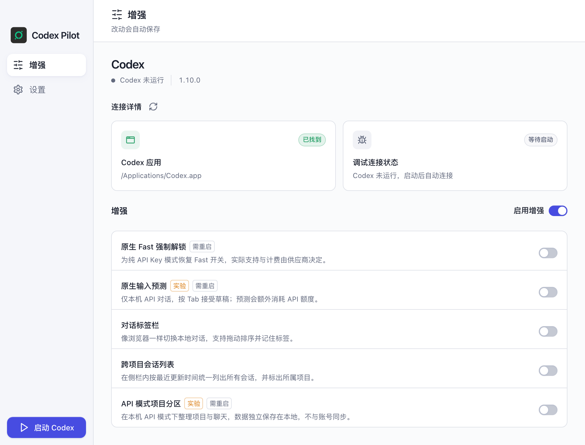
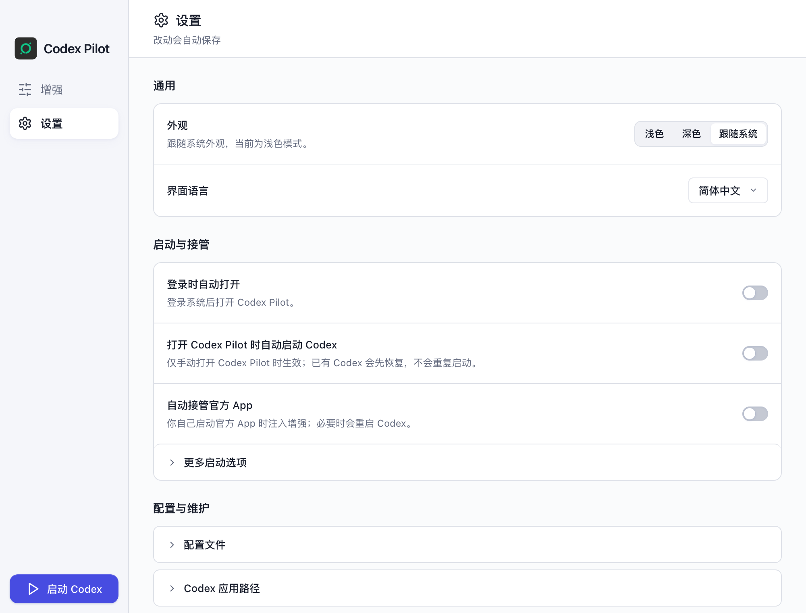
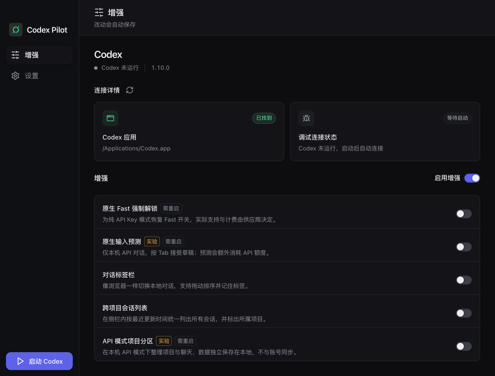

# Codex Pilot · Codex 增强精简版

Codex Pilot 是面向 Codex 桌面端的轻量增强管理器，只服务 Codex。基于 [CodexPlusPlus](https://github.com/BigPizzaV3/CodexPlusPlus)（AGPL-3.0-only）精简而来，现独立维护；非 OpenAI 官方产品，与 OpenAI 无关联。许可与致谢见 [NOTICE.md](NOTICE.md)。

<p align="center">
  
</p>

## 功能

- Codex 启动、注入与自动接管。
- 原生 Fast、输入预测、API 模式项目分区及 Windows 浏览器兼容增强。
- 更新、后台日志记录、安装维护与托盘快捷面板。

已移除语音输入、下一步建议、插件市场、MCP / Skills 管理、用户拓展、微信连接、皮肤管理、供应商管理、模型网关、其他 Agent、管理器会话管理、历史修复、工具页和使用模式选择。增强模型调用直接读取 Codex 原生配置，不维护独立供应商配置。

上游发布包与本项目精简版本的功能范围不同，本文档描述的是本项目当前范围。

管理器采用窄侧栏：左侧切换“增强 / 设置”，底部垂直排列 Codex 运行按钮。运行状态与增强同屏，连接详情以两张常驻卡片展示；配置、维护和版本更新集中到设置页。

<p align="center">
  
  <br>
  <sub>设置页：外观与语言、启动与接管、配置维护、版本更新</sub>
</p>

<p align="center">
  
  <br>
  <sub>深色主题跟随系统外观切换</sub>
</p>

## 本地开发与检查

前端位于 `apps/codex-plus-manager`，Rust 核心位于 `crates/codex-plus-core`，数据层位于 `crates/codex-plus-data`。

```sh
npm --prefix apps/codex-plus-manager run check
npm --prefix apps/codex-plus-manager test
cargo test -p codex-plus-core
cargo test -p codex-plus-data
cargo test -p codex-plus-manager --lib
```

集成回归应将 `CODEX_HOME` 和 `CODEX_PLUS_STATE_DIR` 指向临时目录，隔离日常使用的数据。修改注入分片后运行 `node scripts/assemble-renderer-inject.mjs`。

只构建、不启动应用：

```sh
npm --prefix apps/codex-plus-manager run vite:build
cargo build --release -p codex-plus-manager
```

修改后构建并启动 Codex Pilot 供实测；需要重启 Codex 时通知用户。开发规范见 [AGENTS.md](AGENTS.md)。

## 许可证

沿用上游 [AGPL-3.0-only](LICENSE)。[English](README_EN.md)
