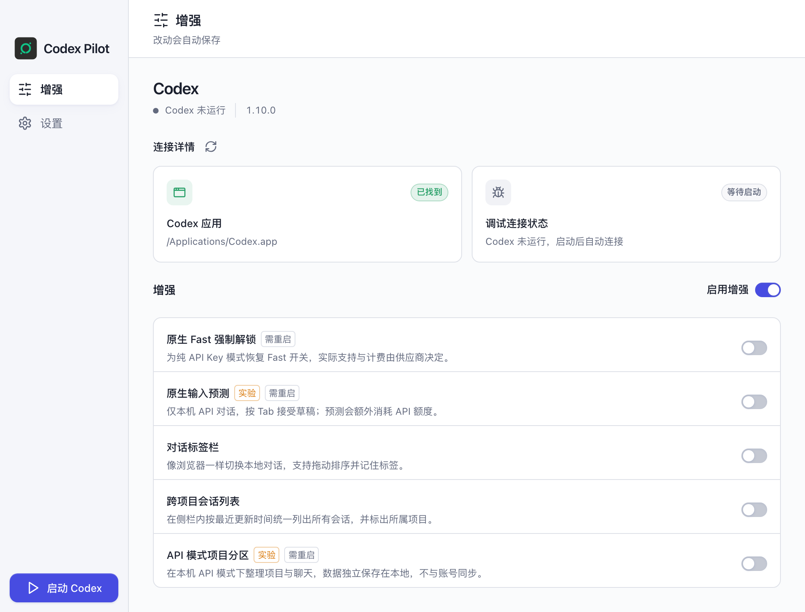
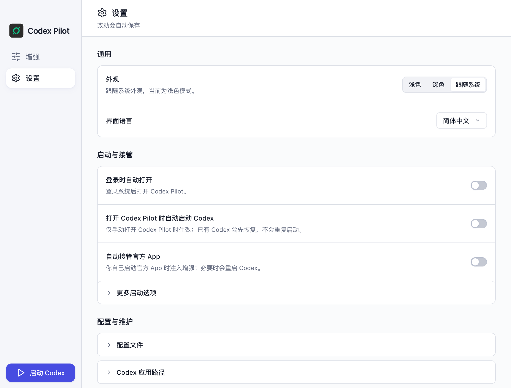
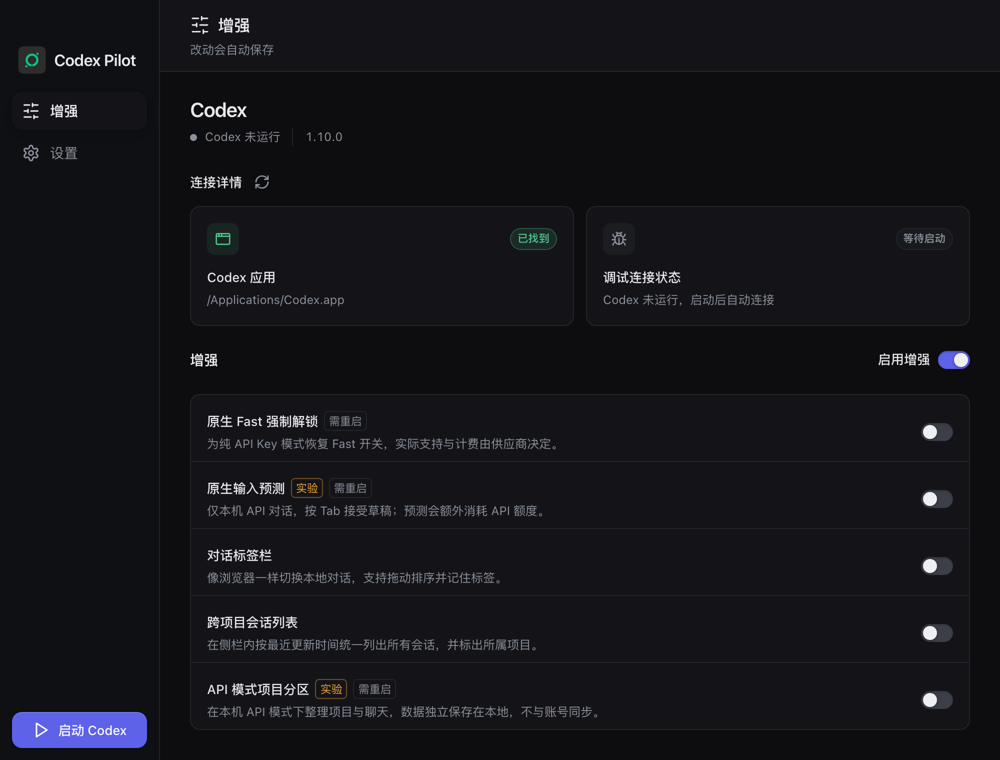

# Codex Pilot · Codex Enhancement Edition

Codex Pilot is a lightweight companion manager for the Codex desktop app. It is a stripped-down, independently maintained derivative of [CodexPlusPlus](https://github.com/BigPizzaV3/CodexPlusPlus) (AGPL-3.0-only). Not an official OpenAI product and not affiliated with OpenAI. See [NOTICE.md](NOTICE.md).

<p align="center">
  
</p>

It retains Codex launch and injection, native Fast, input predictions, API project sections, Windows browser compatibility, updates, background logging, installation maintenance and the tray panel.

The manager uses a narrow sidebar for Enhancements and Settings, with vertically stacked Codex controls at the bottom. Runtime status and enhancements share one page, including two always-visible connection cards; configuration, maintenance and version updates stay in Settings.

<p align="center">
  
  <br>
  <sub>Settings: appearance and language, startup and takeover, configuration, updates</sub>
</p>

<p align="center">
  
  <br>
  <sub>Dark theme follows the system appearance</sub>
</p>

Plugin marketplace, dsh plugin import, MCP / Skills management, user extensions, Weixin connection, skin management, provider management, model gateway, other agents, manager session management, history repair, utility pages and usage-mode selection have been removed. Enhancement model requests read the active native Codex configuration and call the Responses endpoint directly.

See the [development instructions](AGENTS.md). Upstream release packages have a different feature set.

## Build without launching

```sh
npm --prefix apps/codex-plus-manager run check
npm --prefix apps/codex-plus-manager run vite:build
cargo build --release -p codex-plus-manager
```

Run regression tests with temporary `CODEX_HOME` and `CODEX_PLUS_STATE_DIR` directories. Reassemble injection assets after editing fragments with `node scripts/assemble-renderer-inject.mjs`. Build and reopen Codex Pilot for local verification; notify the user before any required Codex restart.

Licensed under [AGPL-3.0-only](LICENSE). [中文](README.md)
